# Diagramas de arquitectura C4 — fuentes editables

Estos diagramas son **fuentes Mermaid listas para exportar**, no capturas de una herramienta ni de un despliegue real.

## C4 nivel 1 — Contexto

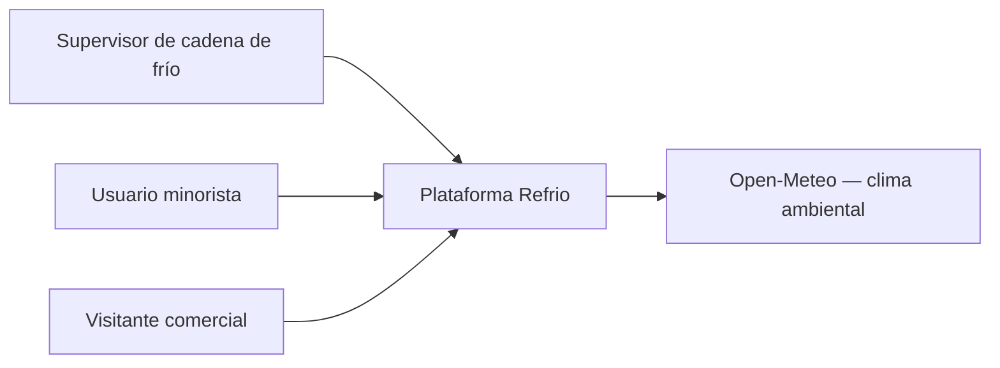

## C4 nivel 2 — Contenedores

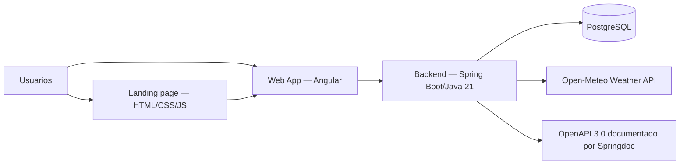

Nota: landing y web app están representados como contenedores lógicos; comprobar sus URL y despliegues definitivos con el equipo.

## C4 nivel 3 — Componentes del contenedor Backend

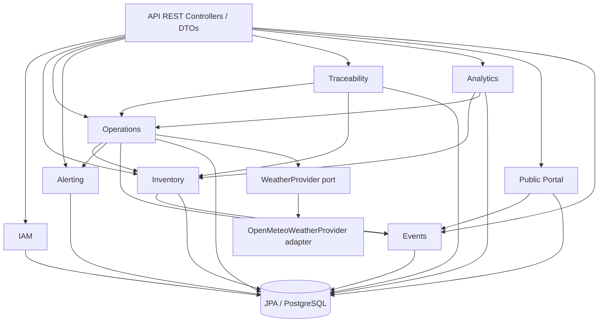

## C4 nivel 3 — componentes por bounded context

Cada sección siguiente representa un componente lógico. Los nombres de puertos y adaptadores corresponden a archivos Java reales.

### iam

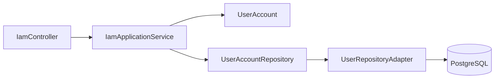

### inventory

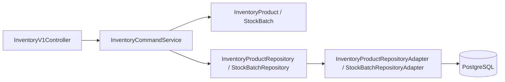

### operations

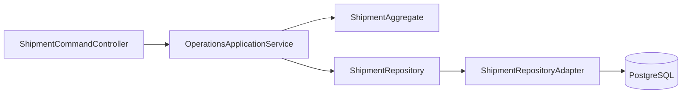

### alerting

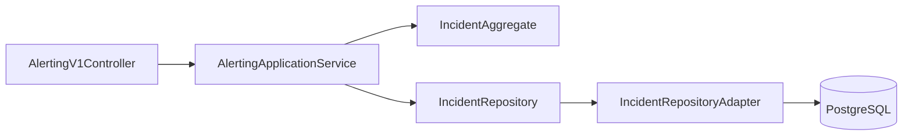

### traceability

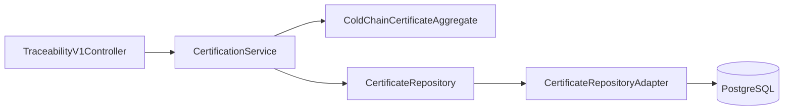

### analytics

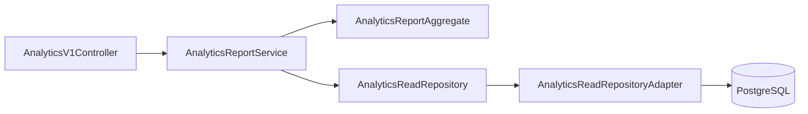

### publicportal

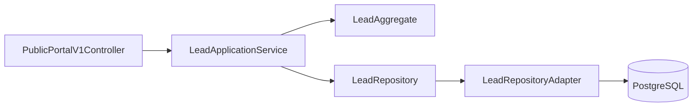

### events

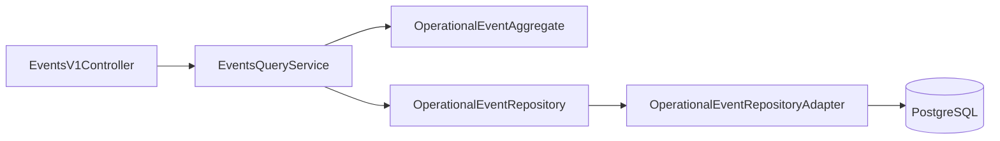
