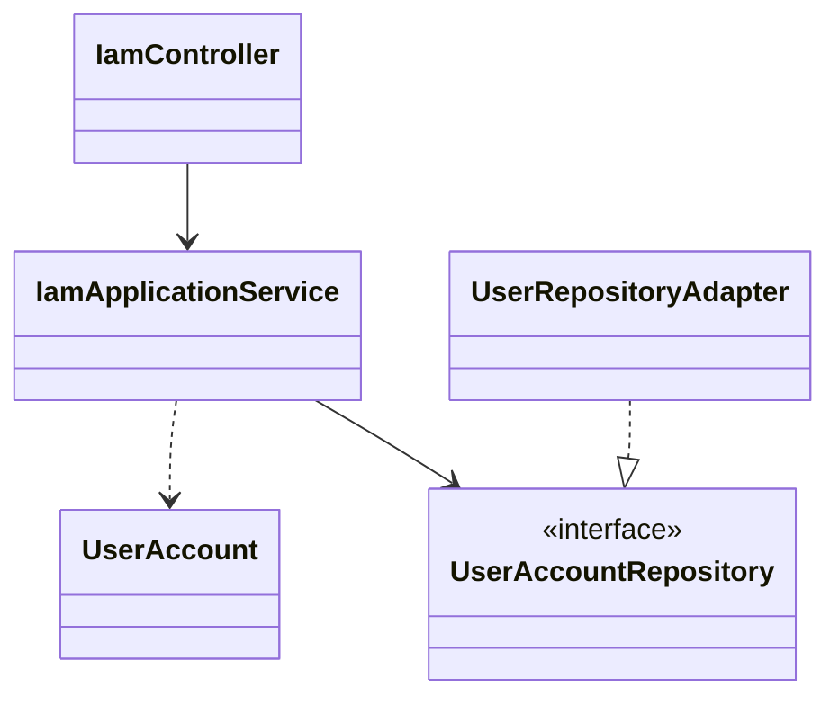
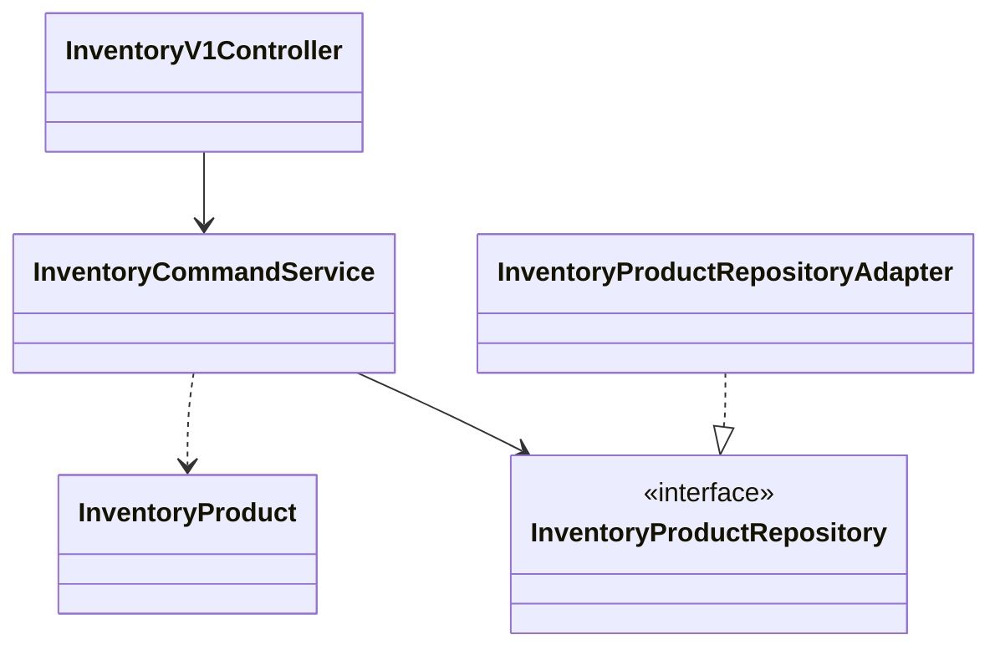
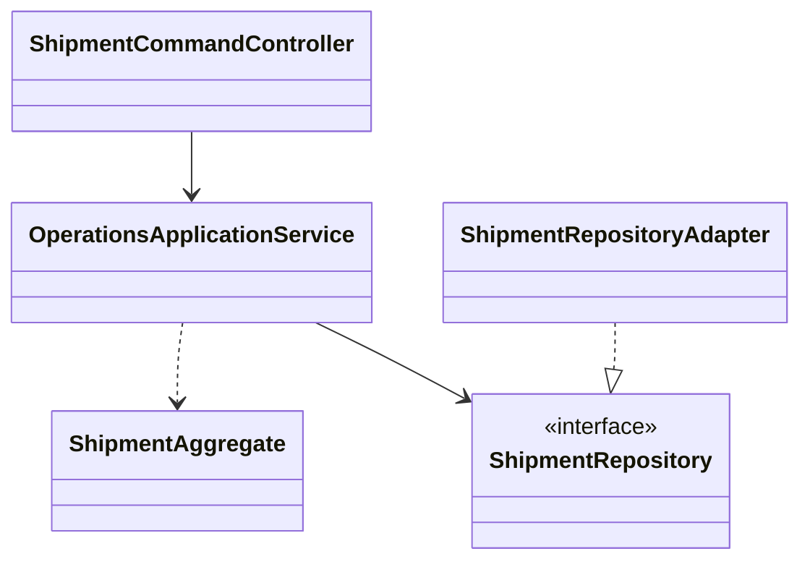
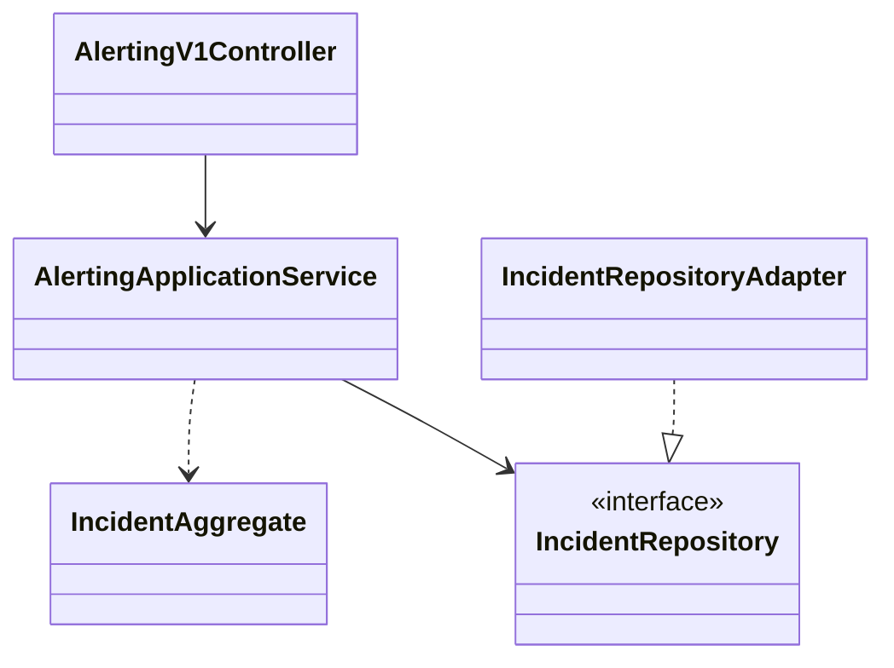
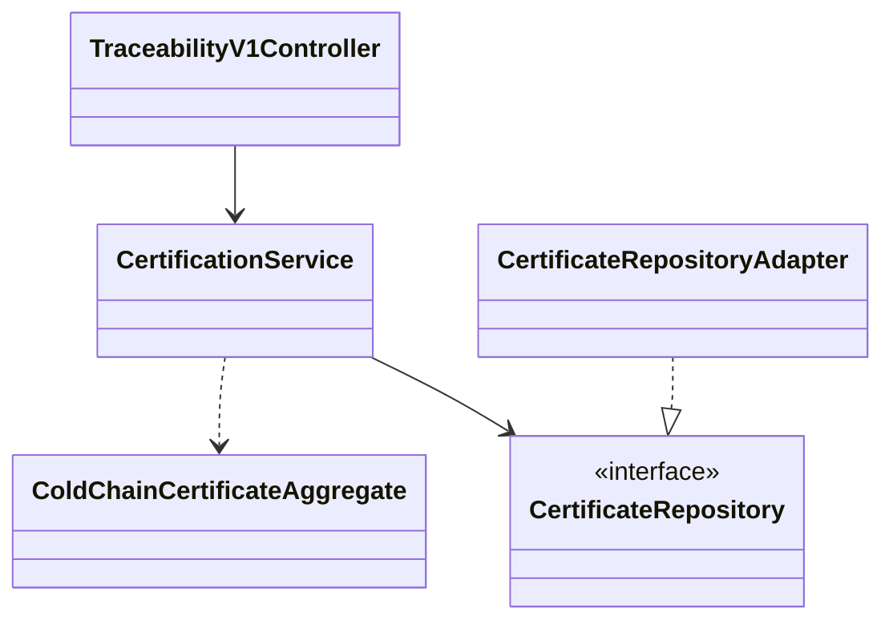
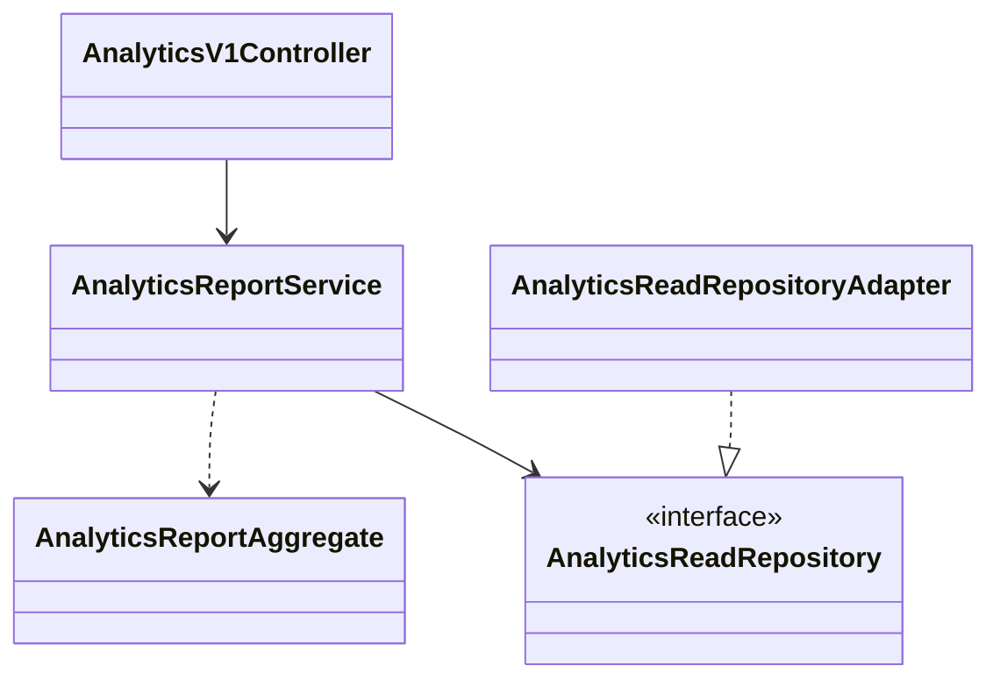
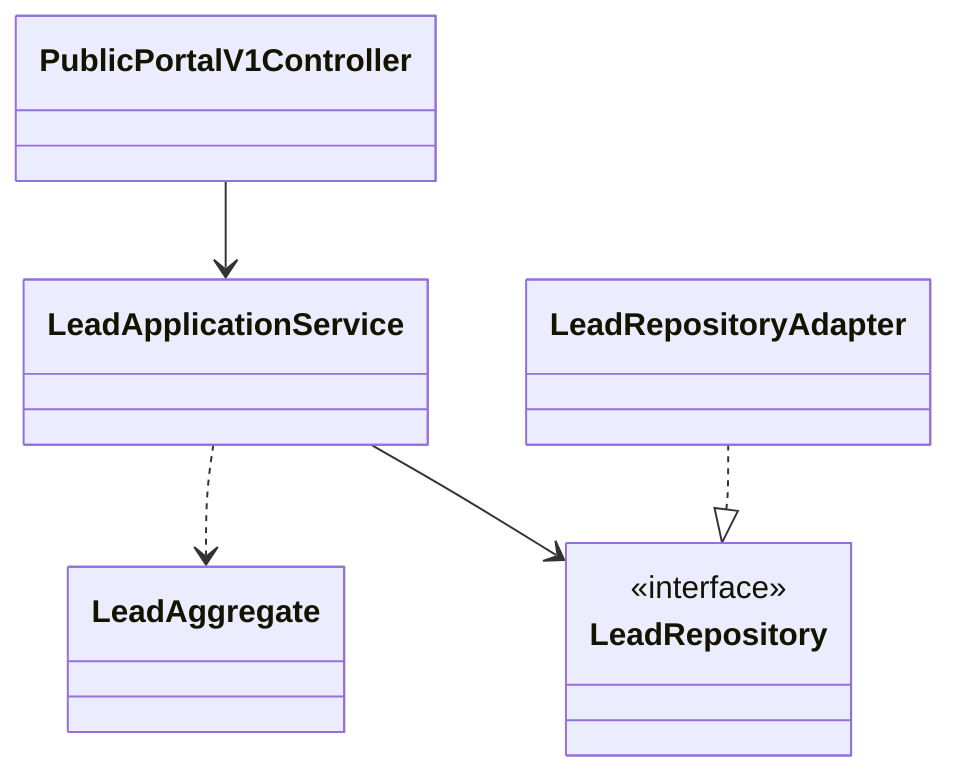
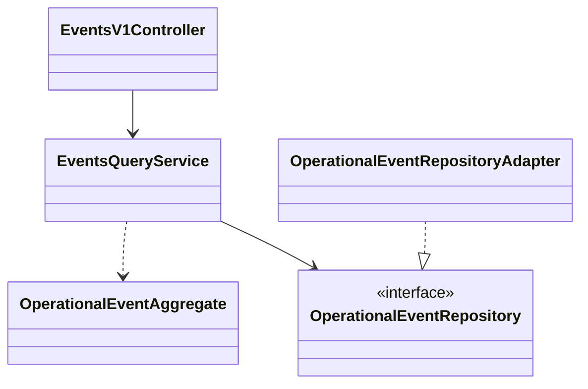

# Diagramas de clases UML — modelo de implementación

Nombres basados en el código Java presente. Relaciones esquemáticas para el informe: ampliar atributos y visibilidad consultando los sources en IntelliJ antes de capturar los diagramas definitivos.

## iam

## inventory

## operations

## alerting

## traceability

## analytics

## publicportal

## events

