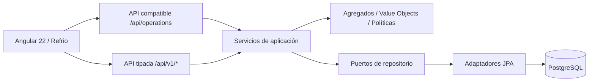

# REFRIO · Arquitectura DDD / Spring Boot

## Correspondencia con el proyecto Learning Center de clase

El ZIP `learning-center-platform-master-main.zip` usa el patrón de un bounded context académico
(`learning`) con `domain/model/aggregates`, `valueobjects`, `repositories`, adaptador JPA y
estructura compartida. Aquí aplicamos la misma distinción **a ocho contextos del negocio Refrio**,
no a ocho paquetes sin comportamiento. Se conserva `shared` exclusivamente para infraestructura
transversal; **shared no es un noveno bounded context**.

| BC en Angular | Paquete backend | Raíz de agregado principal | VO / regla | Puerto de repositorio | Adaptador |
|---|---|---|---|---|---|
| IAM | `iam` | `UserAccount` | `Username`, `EmailAddress`, `UserRole` | `UserAccountRepository` | `UserRepositoryAdapter` (JPA `app_users`) |
| Inventory | `inventory` | `InventoryProduct`, `StockBatch` | `StockQuantity`, `ExpirationDate`, FEFO | `InventoryProductRepository`, `StockBatchRepository` | Adaptadores `InventoryProduct`/`StockBatch` |
| Operations | `operations` | `ShipmentAggregate`, `ClientAggregate`, `SupplierAggregate` | `ShipmentStatus`, `ShipmentRoute`, `ShipmentPolicy` | `ShipmentRepository`, `BusinessPartnerRepository` | Adaptadores Shipment y BusinessPartner |
| Alerting | `alerting` | `IncidentAggregate`, `AlertAggregate` | `IncidentState`, `IncidentDecision` | `IncidentRepository`, `AlertRepository` | Adaptadores Incident y Alert |
| Traceability | `traceability` | `ColdChainCertificateAggregate` | `TemperatureEvidence`, `CertificateFingerprint` | `CertificateRepository` | `CertificateRepositoryAdapter` |
| Analytics | `analytics` | `AnalyticsReportAggregate` (reporte inmutable) | `Percentage`, `OperationalMetrics` | `AnalyticsReadRepository` | `AnalyticsReadRepositoryAdapter` |
| Public Portal | `publicportal` | `LeadAggregate` | `ContactEmail`, `LeadStatus` | `LeadRepository` | `LeadRepositoryAdapter` |
| Events | `events` | `OperationalEventAggregate` | `EventOutcome` | `OperationalEventRepository` | `OperationalEventRepositoryAdapter` |

## Diseño de cada bounded context

```text
com.refrio.platform
├── iam/
├── inventory/
├── operations/
├── alerting/
├── traceability/
├── analytics/
├── publicportal/
├── events/
└── shared/  (soporte técnico transversal; NO es un BC)

<context>/
├── domain/
│   ├── model/aggregates/       invariantes + reglas de consistencia
│   ├── model/valueobjects/      identidad, cantidades, estados y restricciones
│   ├── model/repositories/      contratos independientes de Spring/JPA
│   └── services/                políticas del dominio, cuando corresponde
├── application/                casos de uso, comandos y consultas
├── infrastructure/
│   └── persistence/jpa/adapters/ implementaciones de puertos
└── interfaces/rest/            controladores, DTOs y recursos
```

En IAM la versión heredada usa `domain/model/repositories/UserAccountRepository` y
`infrastructure/persistence/jpa/{entities/UserEntity,repositories/UserJpaRepository,adapters/UserRepositoryAdapter}`.
El tipo `UserAccount` se encuentra en `domain/model/aggregates/` como agregado puro de dominio.

## Flujo funcional (DDD + Anti-Corruption Layer)



`/api/operations` es una **capa de compatibilidad**, porque el frontend existente usa
`{ "args": [] }` y snapshots del antiguo JSON Server. Se mantiene temporalmente al lado de
endpoints tipados. El dominio nunca recibe `JsonNode`: esos formatos se usan únicamente en
la orquestación de compatibilidad y persistencia. La lógica de FEFO está en Inventory, la
máquina de estados en Operations, la incidencia en Alerting y la auditoría inmutable en Events.

## Decisión de persistencia (trade-off real)

- IAM tiene entidad y tabla JPA específicas `app_users`; guarda contraseñas con BCrypt.
- Los otros siete BC usan repositorios **tipados**, adaptados a la tabla JPA
  `resource_records` para mantener intacta la forma dinámica del frontend y permitir
  migrar desde `db.json` sin perder datos opcionales.
- Cada adaptador selecciona únicamente sus recursos propios. El mutex pesimista
  transaccional serializa operaciones de inventario, expedición y merma entre réplicas.
- La persistencia de operaciones **NO está completamente normalizada**: para una solución
  empresarial definitiva se deben crear tablas por agregado y migraciones Flyway separadas,
  reemplazando exclusivamente los adaptadores. No se presenta el modelo documental como
  si fuera idéntico a tablas relacionales por agregado.
- `@Transactional` agrupa cambios de lotes, productos, envíos y publicación de eventos.
- Las métricas de Analytics son read models calculados desde hechos persistidos,
  evitando indicadores arbitrarios.

## Reglas y límites de contexto

**Inventory**: no puede disminuir el stock por debajo de 0; los lotes vencidos/bloqueados
no forman parte del FEFO. La lista FEFO se ordena por vencimiento e ID.

**Operations**: el escaneo debe coincidir con el plan FEFO. Un envío solo avanza
`Preparing → In Transit → Awaiting Receipt → Delivered/Rejected`. La recepción se
valida contra la asignación prevista, no permite exceso ni una segunda confirmación.

**Alerting**: `IN_REVIEW → ACTION_RECORDED → RESOLVED`. Para resolver se exige
una acción correctiva registrada y una verificación.

**Traceability**: los certificados se crean tras una recepción y exigen muestras
registradas. La huella SHA-256 es un **checksum**, no una firma electrónica acreditada.

**Public Portal**: los leads solo progresan en su ciclo comercial; un contacto
cerrado no se reabre implícitamente. Registro público sin autenticación; consulta
restringida a supervisores.

**Events**: la auditoría se incorpora en la transacción de negocio. Los eventos
persistidos no pueden sobrescribirse vía `append()`.

**IAM**: roles `Supervisor` y `Minorista`; token JWT firmado, autorización de servidor
además de los guards Angular, credenciales nunca en respuestas.

**Analytics**: estadísticas basadas en datos reales y ámbito del usuario autenticado.

## Qué no está implementado

No incluye controlador físico de sensores, SMS/WhatsApp, firma digital de terceros,
PDF certificado, tracking GPS real ni un despliegue activo. Se requieren integraciones
específicas y credenciales provistas por los servicios correspondientes.

## Revisión de la estructura completa

- Cada uno de los ocho contextos está en `src/main/java` **y** en `src/test/java`, con sus propias pruebas.
- Inventory tiene casos de uso tipados para productos, lotes, mermas y temperatura (en `InventoryCommandService`), con repositorios y ledger de lecturas/mermas.
- IAM separa `domain/model/aggregates`, `domain/model/valueobjects`, `domain/model/repositories` y persistencia JPA (`entities`, `repositories`, `adapters`) igual que el ejemplo Learning Center.
- El contrato JSON de la capa legacy quedó en `shared/application/compatibility/DocumentRepository`; las clases puras de dominio no dependen de Jackson.
- `scripts/check_ddd_structure.py` detecta módulos o carpetas de pruebas faltantes y `scripts/verify_domain.py` prueba todos los contextos sin herramientas externas de compilación.
- El acceso al modelo documental de compatibilidad **no** equivale a ocho esquemas relacionales por contexto; el README identifica esta limitación.


## Mejoras 1.1.0 — detalles verificables

- `ShipmentCommandController`: endpoints REST de comandos de despacho con DTOs `@Valid`, manteniendo el adapter legacy `/api/operations`.
- `RecipientIdentityPort` en Operations + `IamRecipientIdentityAdapter`: evita crear despachos hacia receptores ficticios o con rol no Minorista.
- `ShipmentTemperaturePolicy`: validación temporal `createdAt ≤ reading.at ≤ receipt.at` y cobertura por producto antes de certificar. No equiparar clima ambiente (proveedor externo) con telemetría de carga.
- Error HTTP con códigos/estados y mensajes por `Accept-Language`, inglés por defecto. Descripciones heredadas en español permanecen en `detail`.
- `V2__resource_json_indexes.sql`: índices PostgreSQL y vistas SQL de lectura de cada contexto; sigue siendo un modelo documental, no una normalización por entidad.
- GitHub Actions: H2/JUnit, Postgres 16, Flyway, OpenAPI y autenticación de usuario demo. La ejecución real de Actions queda pendiente de publicación.
