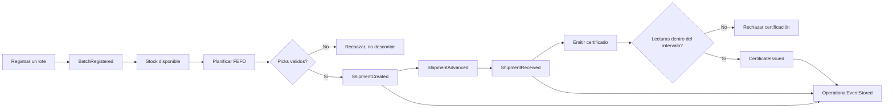

# Design-level EventStorming — Refrio

Diagrama fuente documental: revisión propuesta, **no es evidencia de una sesión colaborativa**. La evidencia real del taller debe incorporarse al informe del equipo.

| Bounded context | Actor / comando | Evento de dominio | Aggregate root | Query / proyección | Invariante |
|---|---|---|---|---|---|
| IAM | Visitor `RegisterUser`, `SignIn` | UserRegistered, SessionIssued | UserAccount | GetCurrentUser | Contraseña BCrypt, rol validado |
| Inventory | Supervisor `RegisterBatch`, `RecordLoss`, `RecordTemperature` | BatchRegistered, LossRecorded, ReadingRecorded | StockBatch, InventoryProduct | GetProducts, GetBatchesFefo | Stock no negativo, FEFO real |
| Operations | Supervisor `CreateShipment`, `AdvanceShipment`; Recipient `ReceiveShipment` | ShipmentCreated, ShipmentAdvanced, ShipmentReceived | ShipmentAggregate | ListShipments, GetShipment | Estado/transición/propiedad válidos |
| Alerting | User `ReviewIncident`, `ResolveIncident` | IncidentReviewed, IncidentResolved | IncidentAggregate | GetAlerts/GetIncidents | Verificación para cierre |
| Traceability | User `IssueCertificate` | CertificateIssued | ColdChainCertificateAggregate | GetCertificate, FindByQr | Datos de temperatura de la entrega, no de otro periodo |
| Analytics | User `GenerateOperationalReport` | ReportGenerated (proyección; no necesariamente persistido) | AnalyticsReportAggregate | GetOperationalReport | Indicadores derivados de hechos, no valores inventados |
| Public Portal | Visitor `SubmitLead`; Supervisor `UpdateLeadStatus` | LeadSubmitted, LeadProgressed | LeadAggregate | GetLeads | Correo válido y transición monotónica |
| Events | System `PublishOperationalEvent` | OperationalEventStored | OperationalEventAggregate | ListOperationalEvents | Append-only y misma transacción |

Conexiones entre contextos: las políticas `FefoPolicy`, `ShipmentPolicy`, `ShipmentTemperaturePolicy` se invocan desde casos de uso; el contrato de eventos pertenece al contexto `events`. Para evitar un acoplamiento temporal roto, la capa de compatibilidad heredada `/api/operations` y la API tipada `/api/v1` realizan las mismas mutaciones de negocio.
