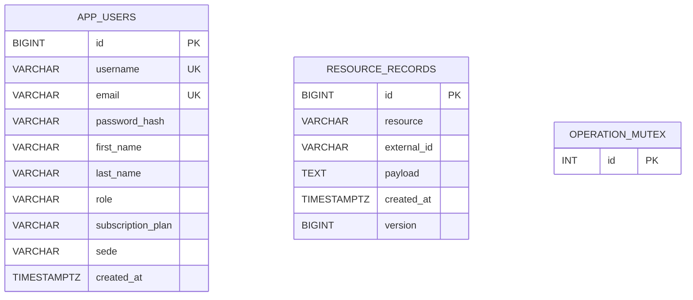

# Refrio — Diseño físico de persistencia y ERD

El esquema REAL de la aplicación está en Flyway `db/migration/V1__initial.sql` y en las entidades JPA. El diagrama no debe confundirse con un modelo relacional normalizado para todos los agregados.

`resource_records` tiene UNIQUE `(resource, external_id)`, versión optimista `@Version` y payload JSON serializado. `V2__resource_json_indexes.sql` añade índices de consulta sobre campos JSON y vistas SQL de lectura por contexto (PostgreSQL). El lock del mutex se usa para serializar operaciones de inventario/FEFO.

## Modelo lógico de los ocho contextos

| Bounded context | Estructuras persistidas/proyectadas | Clave o relación lógica |
|---|---|---|
| IAM | `app_users` | PK id; unique username,email |
| Inventory | `resource_records` resources `inventory`, `bodeguero-inventory`, `batches`, `losses`, `telemetry` | batches.productId → products.id, audiencia Supervisor/Minorista |
| Operations | resources `shipments`, `clients`, `suppliers` | shipment.clientId → client.id, shipment.recipientId → app_users.id; allocations.batchId → batches.id |
| Alerting | resources `alerts`, `incidents` | incident.id → alert.id |
| Traceability | resource `certificates` | certificate.shipmentId → shipments.id |
| Analytics | proyección desde inventory, shipments, losses | no repositorio mutable para métricas calculadas |
| Public Portal | resource `leads` | lead.id identifica contacto |
| Events | resource `events` | aggregateId referencia variable por contexto; append-only |

**Advertencia técnica:** esas referencias entre atributos de JSON son **invariantes en código, no foreign keys físicas**. No afirmar en el informe que existen PK/FK normalizadas por todos los contextos. Para aspirar a máxima calidad de diseño de datos, migrar los agregados hacia tablas propias y añadir FK SQL/constraints sin romper el contrato Angular.

## Vistas de lectura PostgreSQL

V2 crea vistas de lectura de recursos `bc_inventory_products`, `bc_inventory_batches`, `bc_operations_shipments`, `bc_alerting_incidents`, `bc_traceability_certificates`, `bc_events_operational_events`, `bc_publicportal_leads`, `bc_analytics_snapshot`. Son proyecciones SQL; los adaptadores actuales continúan utilizando el puerto `DocumentRepository`.
