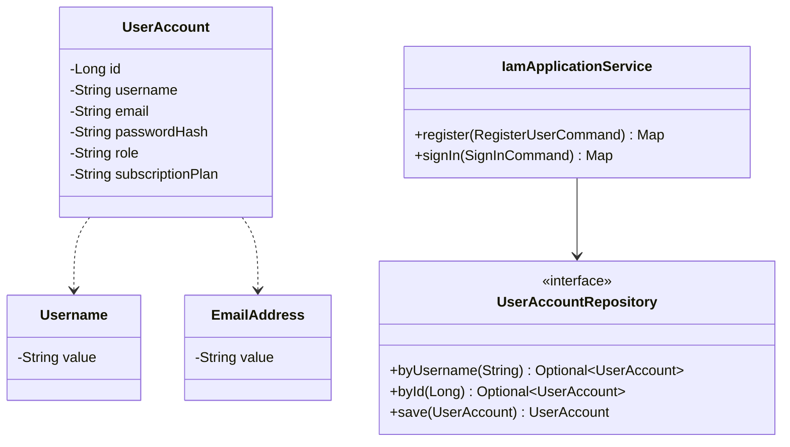
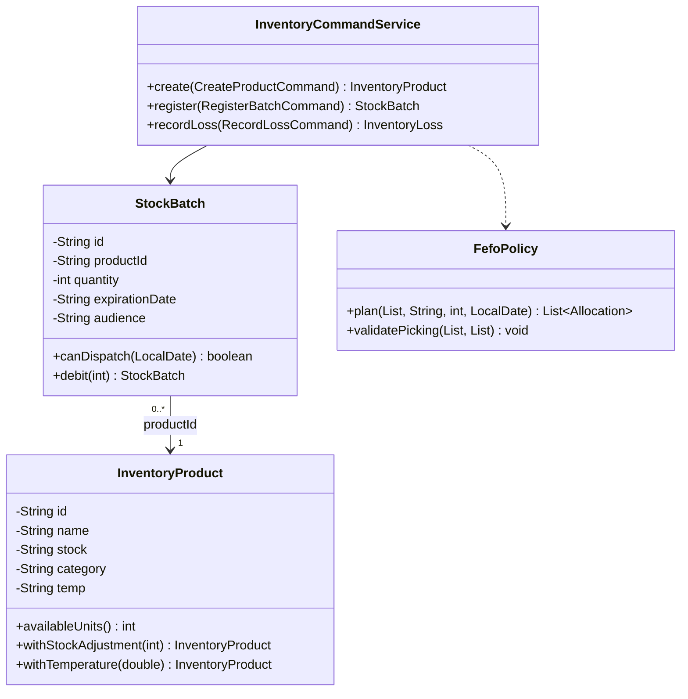
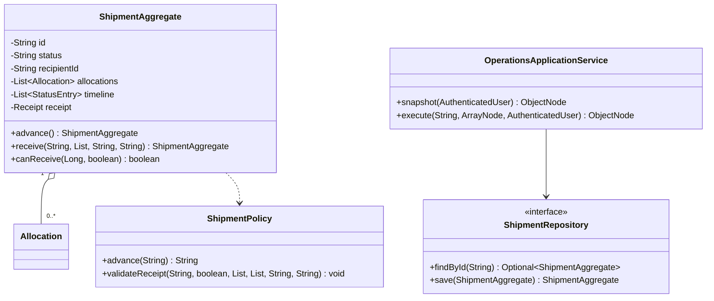
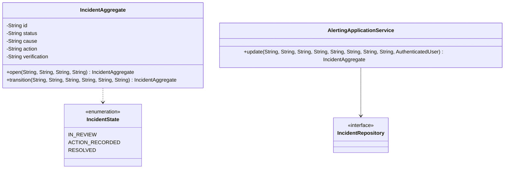
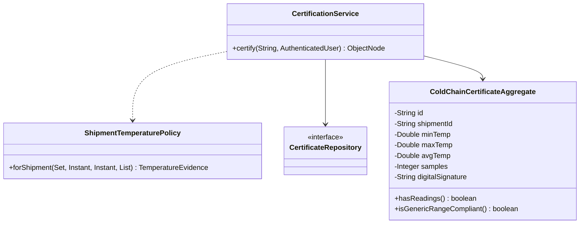
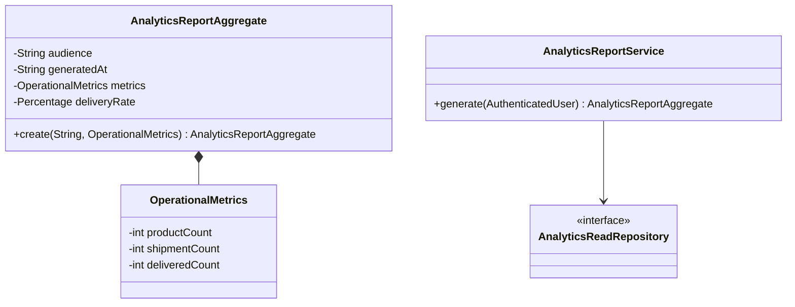
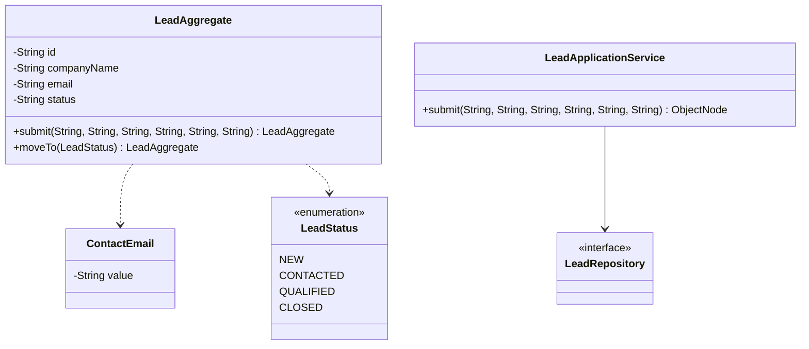
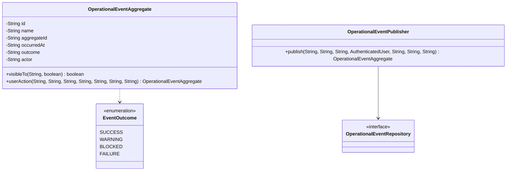

# UML de diseño detallado — los ocho bounded contexts

Fuente editable Mermaid, extraída de las clases reales de la versión 1.1.0. Las propiedades representadas son el núcleo del aggregate y no todos los miembros triviales. `-` indica propiedad encapsulada de un `record` y `+` operación pública. Las relaciones entre BC son **referencias por identificador**, no asociaciones JPA navegables implícitas.

## IAM

## Inventory

## Operations

## Alerting

## Traceability

## Analytics

## Public Portal

## Events

Estos diagramas no reemplazan las capturas y explicaciones que el enunciado pide realizar con las herramientas del curso; la fuente Mermaid debe ser revisada visualmente antes de insertarla en el Document Report.
